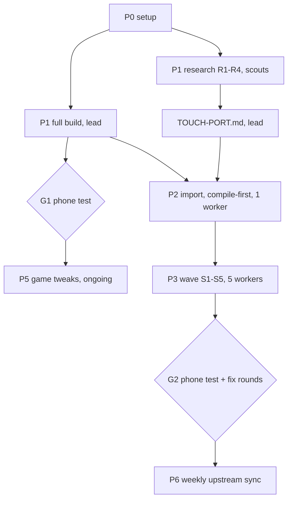

# Fork plan: VoidLink touch gamepad + game tweaks

Owner: Filip (user). Lead: omp session started in `~/Developer/Madeira`. Fork-only document.

## Goal

1. Replace Madeira's touch gamepad with VoidLink's widget system (profiles, macros/multi-action buttons, folders, auto-tap, wheels, mouse pads, gyro, layout editor), driven through Madeira's existing input sinks. Port VoidLink code; do not reinvent it.
2. Per-game tweaks and fixes, mostly per-game config files (no rebuild), later `GameRecommendations.swift` entries.
3. Keep pulling upstream (`willfaust/Madeira`) fixes; keep our changes in our own files.

## Facts (2026-10-30)

| Item | Value |
|---|---|
| Upstream base | `willfaust/Madeira` `main` @ `c2c1b03a9e36ef986c980b9eae3c14d05a372db1` (CI 13/13 green). Latest IPA v0.1.3 = `4e9d45a` (Oct 3), ~800 commits behind |
| Submodule pins | FEX `6fb1b507`, wine `df1c5ea5`, dxmt `05876bb6`, madeira-dock `8c98616a` |
| VoidLink source | `The-Fried-Fish/VoidLink-previously-moonlight-zwm`, branch `Integration` @ `fa42805997b7f82f1a9dc04d72e149cde4ebd07b` (GPL-3.0-only; Madeira is GPL-3.0-or-later → combined work GPL-3.0; most VoidLink headers say "All rights reserved" → fine for personal use, resolve before publishing) |
| Build host | MacBook Air M4, 10 cores, 16 GB, macOS 27.0.1, Xcode 27.2, Command Line Tools 27.2 (updated 2026-10-30: `build-ipa.sh` upgrades Homebrew `llvm` to 23.x, whose macOS-27 clang config points at the CLT `MacOSX27.sdk`; CLT 26.2 lacked it and broke the `dock` self-test). Lid closed = sleep = dead downloads; keep it open during builds. ~67 GB free after clone |
| Device | iPhone 15 Pro, iOS 27.0.1, free Apple ID (7-day profiles; increased-memory yes, extended-virtual-addressing no), JIT via StikDebug / in-app pairing |
| Installed app | Madeira v0.1.3, bundle ID `com.willfaust.madeora.BJL26V87ND`, installed by SideInstaller 1.6.2 (appends team suffix `BJL26V87ND` to the IPA's `com.willfaust.madeora`; reinstalling our IPA through SideInstaller keeps the ID and data). Mac has no signing identities; signing happens in SideInstaller. Esoteric Ebb fails with `launch-client-error=28` (likely fixed on main: "Fix Dock launches when Steam launch entries do not start at zero"); Disco Elysium killed at ~6,120 MB (iOS limit ~6,144 MB) |

Research: `docs/fork/research/madeira-recon.md`, `docs/fork/research/voidlink-recon.md`.

## Architecture decisions

- VoidLink widgets never call the stream for gamepad state; they go through `OnScreenControls` → `ControllerSupport` (`setButtonFlag`, triggers, sticks, `updateFinished`), and call `LiSend*` directly only for keyboard/mouse/scroll/controller-touchpad. We keep those names and reimplement them over Madeira:
  - gamepad → `GamepadInput.shared.touch(owner:control:value:)` → `winios_gamepad_set_state` (XInput pad polled by Wine `xinput`);
  - keys → `winios_post_key(vk, down)` (VoidLink already uses Windows VK codes);
  - mouse buttons/moves/wheel → `winios_pointer(x, y, flags, data)` (capabilities to verify in P1, R2);
  - DS4 touchpad → Madeira HID DualSense mode (`winios_hidpad`), if `MADEIRA_PAD_MODE=dualsense`.
- Layout: `third_party/voidlink/` = verbatim reference copy at `fa42805` (not compiled, provenance). `app/Madeira/VLTouch/{Model,Commands,Sink,Widgets,Editor,Host}/` = compiled port.
- Keep VoidLink's ObjC files and class names (`OSCProfile`, `OnScreenButtonState`) so NSKeyedArchiver profiles exported from the VoidLink app import unchanged.
- Shared registries (`project.pbxproj`, bridging header) are edited once in the contract task; `ContentView.swift` gets one minimal hook in the integration task.
- Feature switch `touch-system = voidlink` in `madeira.cfg` (default: Madeira's own controls) so upstream's touch system keeps working.
- Per-game profile binding is new (VoidLink has one global selection): stored with the library entry (`controlLayout`-style field).
- Dropped from VoidLink: stream touch modes (absolute/relative/native passthrough), pen/pencil, mic, PiP, host pairing/crypto, Moonlight networking/stats, controller navigation of VoidLink's screens (`ControllerNavigator`, radial menu, controller-as-mouse; D4), SVGKit (D2), non-English strings (D3). Deferred: DS4 touchpad widget and controller motion passthrough (need upstream `GamepadInput.swift` HID changes).
- Port design, sink contract, file map and decisions D1-D4: `docs/fork/TOUCH-PORT.md`.

## Phases

### P0 Setup (lead)
- [x] Fork `FilipJur/Madeira`, clone with submodules to `~/Developer/Madeira`, `upstream` remote, branch `fork/main`.
- [x] `.omp/` config, agents, watchdog; `docs/fork/PARALLEL.md`, this plan, research reports.
- [x] User restarts omp in `~/Developer/Madeira`; verify `omp config get modelRoles`, isolation settings.
- [x] Smoke isolated `worker` (2026-10-30): branch `omp/task/SmokeP0a` with one signed-off commit, `fork/main` untouched, model `muse-spark-1.3-contributor`, advisor note present, clone has submodules, clone cost ≈20 MB (APFS). Branch deleted. Clones live in `~/.omp/wt/<id>/m`.

### P1 Baseline build + research (parallel)
- [x] Lead: `JOBS=4 ./tools/build-ipa.sh` unchanged (Homebrew deps installed 2026-10-30). Wall ≈65 min (54 min, then a resume of `runtime-components.py build all` → `wine-i386` → `package-ipa.sh` in 11 min after the sleep/CLT fixes). Disk 66.8 → 49.2 GB free (−17.6 GB incl. `app/DerivedData`). Output `dist/Madeira.ipa` 206,489,673 B, sha256 `9dba863a0e51e693…`, `com.willfaust.madeora` 0.1.3 (4) + `.JITHelper`, "Validated complete IPA". Build leaves ~530 tracked prebuilt binaries rewritten, untracked DLLs/licence, and `dxmt` modified: expected, never commit them. Logs `~/Library/Logs/madeira-build/20261030-1733*.log`.
- [x] Lead: installed bundle ID read (see Facts). Sideload the new IPA through SideInstaller so the ID resolves to the same `com.willfaust.madeora.BJL26V87ND`.
- [x] R1 scout → `research/r1-voidlink-deps.md`.
- [x] R2 scout → `research/r2-madeira-sinks.md`. No Wine-driver change needed.
- [x] R3 scout → `research/r3-overlay-host.md`.
- [x] R4 scout → `research/r4-bcd-hook.md`.
- [x] Lead: `docs/fork/TOUCH-PORT.md` drafted. Proposes replacing P2/P3 below with compile-first import + 5-slice wave; pending user approval (D1-D4).
- [ ] **G1** (user, phone): Esoteric Ebb launch, Disco Elysium, current touch controls on the self-built main.

### P2 Import, compile-first (1 worker + parallel helpers; needs P1 native libs to link)
- [x] `third_party/voidlink/` = port-subset files verbatim at `fa42805` + `LICENSE.txt` + `PROVENANCE.md` (67 files, hash-verified).
- [x] Copy into `app/Madeira/VLTouch/`, edits limited to import lines, storyboard module, `ProfileFileContainer` move, each tagged `// VLTouch:` (79 markers).
- [x] Compat stubs, `VLLiShim` + `ControllerSupport` façade with no-op bodies; `GraphicUtils` on `CAShapeLayer` (D2); English-only `VLTouch.xcstrings` (D3).
- [x] Register everything in `project.pbxproj`, bridging header, resources (`.bin`, `VLEditor.storyboard`, imagesets). Gap: `rectangle.and.pencil.and.ellipsis` imageset (S3).
- [x] `touch-system` key (default `madeira`) + catalog regen; nothing hooked.
- [x] `tools/fork/app-check.sh` (≈10-30 s warm on `fork/main`).
- [x] Lead review + merge `323e700`; app-check green on `fork/main`. Wave contract placeholders `2a6d04c`.

### P3 Wave (5 isolated workers, disjoint files; table in TOUCH-PORT.md)
- [x] S1 Sink (worker), S2 Host + hooks (ui-worker), S3 Editor (ui-worker), S4 Pickers (ui-worker), S5 Model + Compat (worker). Launched 2026-10-30, shared rules in the lead session (`local://P3-rules.md`).
- [x] Lead merged S3 `7378ddd`, S4 `66adc19`, S1 `bb28734`, S2 `f6d16d5`, S5 `7b17262`; app-check after each. Integration review (reviewer): stuck legacy pad bits across rebuild, first-run profile select before template import, cursor reset on release → fix round `FixG2a`, merged `2c4774e`.
- [x] G2 IPA: `package-ipa.sh` only (native libs unchanged), 209,506,422 B, sha256 `37fdcfe17872d671…`, contains `VLEditor*.storyboardc`, `widgetTemplates*.bin`, `en.lproj/VLTouch.strings`.
- [x] G2 blocker (2026-10-31): every game hung at "Starting Madeira Dock" — `dockhost.exe` dies in `ucrtbase.dll` `msvcrt_get_thread_data` (`MSVCRT_locale` NULL) during `xtajit64.dll` process attach. Upstream regression from `d4bde29` (#476): the farm rebuild links all delay imports as plain imports → ucrtbase/msvcrt import advapi32/user32 eagerly → msacm32 DllMain runs before ucrtbase's. Upstream issue #495, PR #496 (blanket `UNDELAY=0`, fails the wmvcore media gate). Fork fix `7d54735`: farm build keeps the default undelay list plain, `UNDELAY=0` for the rest (build.sh + targets.py), check `tools/fork/check-farm-delayimports.py` (rebuilt farm: 0 violations). Upstream CI IPA has the same bug. G3 IPA: 209,519,735 B, sha256 `21c0cc5c079a7e57…`.

### G2
- [ ] Lead builds + sideloads; **G2** (user, phone); fix rounds as new workers (`git cherry-pick <base>..omp/task/<name>` first).

### P4 32-bit DX9 adaptation (5 isolated workers, disjoint files)
Source: `docs/fork/research/dx9-path.md` §4 recipe + §5 blockers, `mem-graphics.md` §7, `dx9-batman-fix.md` §5(b), `mem-footprint.md` §5.

| Slice | Agent | Owns | Scope |
|---|---|---|---|
| T1 GfxUI | worker | `app/Madeira/ConfigCatalog.generated.swift` (regen only), `build/tools/gen-config-catalog.py` (one OVERLAY row) | `d3d9` picker offers `wined3d`; fix native scope text, `d3d9shim` message |
| T2 MemRecipe | worker | `app/Madeira/GameRecommendations.swift` + catalog regen | memory recipe for 6 DX9-era games: `pool`, swap keys, `vram-mb`, older-NVIDIA, `DXMT_MAX_VRAM_MB`, Rockstar set for L.A. Noire |
| T3 DX9Mips | worker | `dxmt` submodule (D3D9 sources only) | BC mip clamp on `CreateTexture`, reuse d3d11 policy helper |
| T4 Census | worker | `dxmt` submodule (`dxmt_mem_census.hpp` only) | BC texel sizes per physical format (0 MB, unblocks sizing) |
| T5 Transient | worker | `dxmt` submodule (DXMT allocators only) | footprint-keyed reclaim of staging/copy-temp/argbuf pools (≤ ~450 MB) |

`dxmt/` is a submodule but T3-T5 touch D3D9-only/DXMT-only files; the lead reviews diffs against upstream DXMT (`willfaust/dxmt` `05876bb`) for conflicts. T1/T2 merge first (pure app, app-check), then T3-T5 one at a time with `dxmt` diffs.

### P4 status (lead, 2026-11-01)
- [x] T1 GfxUI merged `81c4bfd` (d3d9 picker + shim message; dxmt gitlink c035b7e).
- [x] T2 MemRecipeB merged (6 per-game recipes + check script; app triple-check green).
- [x] T4 CensusB merged as dxmt `40bbd04` (BC cost by device support; BC1 1024² = 524288 B on A17).
- [x] T3Full rebased onto T4 (`3d404cc`; 339 insertions over 5 files; all TUs compile).
- [x] T5 transient reclaim recovered from worker clone and applied (`41fe66b`; 635 insertions over 11 files; 6/6 TUs compile). T3's initial narrow scope and T5's initial narrow file set were both correctly refused by the workers.
- [x] Tree hygiene: the T1 patch guard fired correctly on a stale working tree; `wine/` restored to applied-opengl-patch state (working tree only, submodule pin `df1c5ea` untouched); farm check 0 violations; ucrtbase delay-imports correct in the IPA.
- [x] G5 IPA: full DXMT rebuild (`build-dxmt-ios.sh`) + windows runtime + package, 209,727,215 B, sha256 `477a934489cf7579…`, pushed as `Madeira-fork-G5.ipa`.

### P5 Game tweaks (ongoing from G1)
- Per-game config (`GameConfigs/<hash>.cfg`, no rebuild): scout reads each log, proposes keys from `ConfigCatalog.generated.swift`. First: Disco Elysium memory (`env.DXMT_MAX_VRAM_MB`, swap tiers), Esoteric Ebb retest.
- Working configs → `GameRecommendations.swift` entries (worker), candidate upstream PRs (`git commit -s`).

### P6 Upstream sync (weekly, lead)
- `git fetch upstream && git switch main && git merge --ff-only upstream/main && git switch fork/main && git merge main`; full build only if submodule pins or native build inputs changed, else app-check; phone smoke.

## Risks

- First from-scratch build is not fully verified upstream; expect snags in P1.
- Disk: build peak unknown (estimate 25–30 GB) + per-clone DerivedData; measure in P0/P1.
- Free Apple ID: no extended-virtual-addressing; memory-heavy games stay capped.
- `winios_pointer` may lack relative mouse / wheel → Wine-driver work (R2 decides).
- VoidLink monoliths (`OnScreenWidgetView.swift` 233 KB, editor VC 132 KB + 110 KB ObjC) — single-owner files, the slowest slices.
- Upstream churn in `ContentView.swift`; keep our hook to a few lines.
