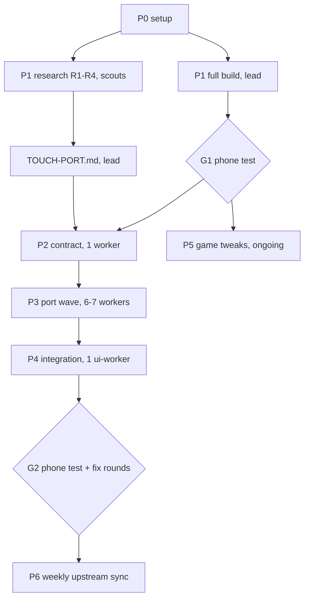

# Fork plan: VoidLink touch gamepad + game tweaks

Owner: Filip (user). Lead: omp session started in `~/Developer/Madeira`. Fork-only document.

## Goal

1. Replace Madeira's touch gamepad with VoidLink's widget system (profiles, macros/multi-action buttons, folders, auto-tap, wheels, mouse pads, gyro, layout editor), driven through Madeira's existing input sinks. Port VoidLink code; do not reinvent it.
2. Per-game tweaks and fixes, mostly per-game config files (no rebuild), later `GameRecommendations.swift` entries.
3. Keep pulling upstream (`willfaust/Madeira`) fixes; keep our changes in our own files.

## Facts (2026-10-30)

| Item | Value |
|---|---|
| Upstream base | `willfaust/Madeira` `main` @ `c2c1b03a9e36ef986c980b9eae3c14d05a372db1` (CI 13/13 green). Latest IPA v0.1.3 = `4e9d45a` (Oct 3), ~800 commits behind |
| Submodule pins | FEX `6fb1b507`, wine `df1c5ea5`, dxmt `05876bb6`, madeira-dock `8c98616a` |
| VoidLink source | `The-Fried-Fish/VoidLink-previously-moonlight-zwm`, branch `Integration` @ `fa42805997b7f82f1a9dc04d72e149cde4ebd07b` (GPL-3.0-only; Madeira is GPL-3.0-or-later → combined work GPL-3.0; most VoidLink headers say "All rights reserved" → fine for personal use, resolve before publishing) |
| Build host | MacBook Air M4, 10 cores, 16 GB, macOS 27.0.1, Xcode 27.2; ~67 GB free after clone |
| Device | iPhone 15 Pro, iOS 27.0.1, free Apple ID (7-day profiles; increased-memory yes, extended-virtual-addressing no), JIT via StikDebug / in-app pairing |
| Installed app | Madeira v0.1.3 via sideload; Esoteric Ebb fails with `launch-client-error=28` (likely fixed on main: "Fix Dock launches when Steam launch entries do not start at zero"); Disco Elysium killed at ~6,120 MB (iOS limit ~6,144 MB) |

Research: `docs/fork/research/madeira-recon.md`, `docs/fork/research/voidlink-recon.md`.

## Architecture decisions

- VoidLink widgets never call the stream for gamepad state; they go through `OnScreenControls` → `ControllerSupport` (`setButtonFlag`, triggers, sticks, `updateFinished`), and call `LiSend*` directly only for keyboard/mouse/scroll/controller-touchpad. We keep those names and reimplement them over Madeira:
  - gamepad → `GamepadInput.shared.touch(owner:control:value:)` → `winios_gamepad_set_state` (XInput pad polled by Wine `xinput`);
  - keys → `winios_post_key(vk, down)` (VoidLink already uses Windows VK codes);
  - mouse buttons/moves/wheel → `winios_pointer(x, y, flags, data)` (capabilities to verify in P1, R2);
  - DS4 touchpad → Madeira HID DualSense mode (`winios_hidpad`), if `MADEIRA_PAD_MODE=dualsense`.
- Layout: `third_party/voidlink/` = verbatim reference copy at `fa42805` (not compiled, provenance). `app/Madeira/VLTouch/{Model,Commands,Sink,Widgets,Editor,Host}/` = compiled port.
- Keep VoidLink's ObjC files and class names (`OSCProfile`, `OnScreenButtonState`) so NSKeyedArchiver profiles exported from the VoidLink app import unchanged.
- Shared registries (`project.pbxproj`, bridging header) are edited once in the contract task; `ContentView.swift` gets one minimal hook in the integration task.
- Feature switch `touch-system = voidlink` in `madeira.cfg` (default: Madeira's own controls) so upstream's touch system keeps working.
- Per-game profile binding is new (VoidLink has one global selection): stored with the library entry (`controlLayout`-style field).
- Dropped from VoidLink: stream touch modes (absolute/relative/native passthrough), pen/pencil, mic, PiP, host pairing/crypto, Moonlight networking/stats.

## Phases

### P0 Setup (lead)
- [x] Fork `FilipJur/Madeira`, clone with submodules to `~/Developer/Madeira`, `upstream` remote, branch `fork/main`.
- [x] `.omp/` config, agents, watchdog; `docs/fork/PARALLEL.md`, this plan, research reports.
- [ ] User restarts omp in `~/Developer/Madeira`; verify `omp config get modelRoles`, isolation settings.
- [ ] Smoke one isolated `worker` on a one-line docs change: branch `omp/task/<name>` with one commit, `fork/main` untouched, Muse model, advisor log present, clone contains submodules + ignored dirs, `df` shows near-zero clone cost. Delete the smoke branch.

### P1 Baseline build + research (parallel)
- [ ] Lead: `./tools/build-ipa.sh` unchanged, background job, overnight, plugged in. Record wall time and disk peak.
- [ ] Lead: read installed app's bundle ID (`xcrun devicectl device info apps`); sign/sideload the new IPA under the same bundle ID and team so Steam login + downloads survive.
- [ ] R1 scout: VoidLink dependency closure for the port subset; per-file keep/stub/drop; storyboard/xib/asset/localization needs.
- [ ] R2 scout: Madeira sink capabilities: `winios_pointer` flags (relative vs absolute move, wheel, middle, X1/X2), `winios_post_key` VK coverage and modifiers, HID DualSense touchpad path, existing gyro support. If relative mouse/wheel is missing, the change lands in the Wine driver — flag before P3.
- [ ] R3 scout: overlay hosting and lifecycle: `TouchControlsHost`/`ControlsWindow`, session start/stop, menu suspension, per-game `controlLayout`, where a settings toggle belongs.
- [ ] R4 scout: how BCD (`thebcd69/bcd-games`) hooks `BCDTouch*` into ContentView; copy the hook shape (not code without §7 attribution).
- [ ] Lead: `docs/fork/TOUCH-PORT.md` = file map, final P3 slicing, sink contract.
- [ ] **G1** (user, phone): Esoteric Ebb launch, Disco Elysium, current touch controls on the self-built main.

### P2 Contract (1 worker, Muse)
- [ ] `third_party/voidlink/` verbatim import at `fa42805` + `PROVENANCE.md`.
- [ ] `app/Madeira/VLTouch/**` skeleton files for every planned file, registered in `project.pbxproj`; ObjC headers in the bridging header.
- [ ] Sink contract: `VLLiShim.h` (`LiSend*` signatures, button-flag constants) and `ControllerSupport`-shaped façade interface, stubbed.
- [ ] `touch-system` config switch, default off.
- [ ] `tools/fork/app-check.sh`: app target only, `CODE_SIGNING_ALLOWED=NO`, per-clone DerivedData under `/tmp`, machine-wide lock (max 2 concurrent).
- [ ] Lead review + merge; app-check green on `fork/main`.

### P3 Port wave (6-7 isolated workers; final split from R1)
| Slice | Agent | Files (under `app/Madeira/VLTouch/`) | Scope |
|---|---|---|---|
| W-A Model | worker | `Model/*` | `OSCProfile`, `OnScreenButtonState`, `OSCProfilesManager` (archive, import/export, templates `.bin`) |
| W-A2 Commands | worker | `Commands/*` | `CommandManager` DSL (`OSCX-OSCY-100MS-OSCB`), VK tables, `RemoteCommand` macros, combo/auto-release helpers |
| W-B Sink | worker | `Sink/*` (+ `Winios.m` if R2 requires) | `LiSend*` shim → winios; `ControllerSupport` façade → `GamepadInput`; mouse/scroll/HID touchpad |
| W-C1 Widget | ui-worker | `Widgets/OnScreenWidgetView.swift` | the 5.1k-line widget class |
| W-C2 Runtime | ui-worker | `Widgets/*` except above | `OnScreenControls` (trimmed), `LayoutOnScreenControls`, `MotionHandler`, `CursorInertia`, `InertialScroller`, `SafeTimer`, `HapticContext`, `AbstractGamepadOverlayView`, `RadialMenuOverlayView` |
| W-D1 Editor | ui-worker | `Editor/LayoutOnScreenControls*` + storyboard | layout editor (add/edit/duplicate/delete/undo/bulk edit) |
| W-D2 Pickers | ui-worker | `Editor/*` except above | `ProfileSelectorViewController`, widget picker, toolbars, strings |

Each worker builds against the P2 stubs, runs `tools/fork/app-check.sh`, fans out helpers internally. Lead merges one at a time.

### P4 Integration (1 ui-worker) + G2
- [ ] Host the VLTouch overlay in the game session; minimal `ContentView.swift` hook; settings toggle; per-game profile binding; map functional buttons (SETTINGS, QUITAPP, SOFTKEYBOARD, PROFILES) to Madeira actions.
- [ ] Lead builds + sideloads; **G2** (user, phone); fix rounds as new workers (`git cherry-pick <base>..omp/task/<name>` first).

### P5 Game tweaks (ongoing from G1)
- Per-game config (`GameConfigs/<hash>.cfg`, no rebuild): scout reads each log, proposes keys from `ConfigCatalog.generated.swift`. First: Disco Elysium memory (`env.DXMT_MAX_VRAM_MB`, swap tiers), Esoteric Ebb retest.
- Working configs → `GameRecommendations.swift` entries (worker), candidate upstream PRs (`git commit -s`).

### P6 Upstream sync (weekly, lead)
- `git fetch upstream && git switch main && git merge --ff-only upstream/main && git switch fork/main && git merge main`; full build only if submodule pins or native build inputs changed, else app-check; phone smoke.

## Risks

- First from-scratch build is not fully verified upstream; expect snags in P1.
- Disk: build peak unknown (estimate 25–30 GB) + per-clone DerivedData; measure in P0/P1.
- Free Apple ID: no extended-virtual-addressing; memory-heavy games stay capped.
- `winios_pointer` may lack relative mouse / wheel → Wine-driver work (R2 decides).
- VoidLink monoliths (`OnScreenWidgetView.swift` 233 KB, editor VC 132 KB + 110 KB ObjC) — single-owner files, the slowest slices.
- Upstream churn in `ContentView.swift`; keep our hook to a few lines.
